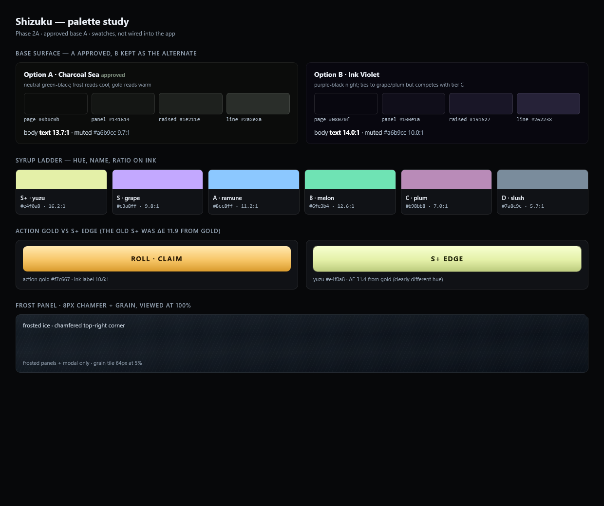
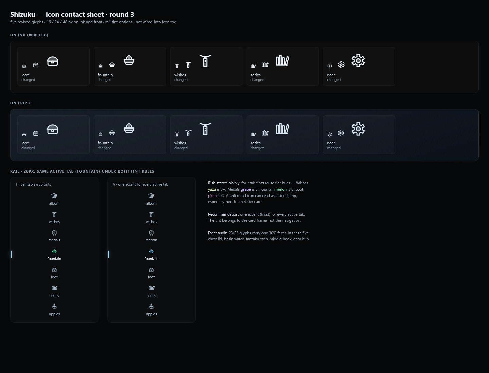

# Shizuku — Art Direction

**Status:** Phase 2A, revised after owner review. Nothing in the app's visual styles changes until this is approved.
**Scope:** the app shell (React + one `styles.css`). `docs/` is not imported by `src/` and `tsconfig.app.json` includes only `src`, so this folder never reaches the bundle.

## 0. Binding rules

1. **No `backdrop-filter` anywhere.** Three exist today and all are removed in Phase 2B: `.modal-backdrop` (`styles.css:1103`, `blur(6px)`), the dead `.help-fab` (`styles.css:2591`, `blur(8px)`), and `preview4.css:1694` (`blur(12px)`). The modal scrim becomes an opaque ink wash.
2. **No `filter: blur()` on full-viewport layers.** The only blur allowed is `drop-shadow` on a medal wrapper.
3. **Reduced motion** for every new animation (`prefers-reduced-motion: reduce` → instant state).
4. **Animation never blocks input.** All motion runs on pseudo-elements/overlays with `pointer-events: none`; game handlers never wait on `animationend`.
5. **Titles and names keep capitals. All other microcopy is lowercase.** Uppercase is reserved for ROLL, CLAIM, primary buttons and stamps.
6. No new dependencies. Icons and the grain tile are authored in-repo.

## 1. Materials — three surfaces, nothing else

| Surface | Recipe | Used on | Replaces |
|---|---|---|---|
| **Frosted ice** | translucent cool pane; 1px light only along the top edge, 1px shadow along the bottom; fine vertical striation; 5% grain; **8px chamfer on the top-right corner**; no outer glow, no uniform ring | modals, Settings sheet, Ripples rows, perk tiles, wish cards, album/series info bands | the white-5% fill + inset ring + soft gradient on every block |
| **Etched ice** | recessed: darker than its surround; top edge in shadow, bottom edge catches light; matte | empty wish slots, basin interior, medal wells, spent keys, inputs | dashed holes, disabled pills, grey slots |
| **Gold hardware** | one warm metal; hard top light; 3px dark base edge; engraved label; no glow | ROLL, CLAIM, primary button, price tags, next-basin tag | gold used as a glow on cards and chips |

**Syrup is colour only, never a surface.** It appears in tier edges, the room wash, medal tints, pips and the rail's active marker.

The **8px chamfer** is deliberate and measurable at 100% (field check in the palette study). It applies to **frosted panels and the modal only** — not the stage card (its frame is a 2C hero), not gold hardware, not inputs. Etched surfaces keep square corners.

## 2. Palette

Swatches and the gold-vs-S+ comparison: `docs/art-direction-palette.png`.

### Base surface — A approved, B kept as the alternate

| | Page | Panel | Raised | Line | Why |
|---|---|---|---|---|---|
| **A · Charcoal Sea** *(approved)* | `#0b0c0b` | `#141614` | `#1e211e` | `#2a2e2a` | neutral green-black; frost reads cool, gold reads warm; the syrup ladder carries all the colour |
| **B · Ink Violet** | `#08070f` | `#100e1a` | `#191627` | `#262238` | purple-black night; ties to grape/plum, but competes with tier C |

Body text `#cdd9e5` (13.7:1 on A, 14.0:1 on B); muted `#a6b9cc` (9.7:1 / 10.0:1).

### Syrup ladder

| Tier | Syrup | Hue | On ink | Chip text (hue 42% → white) | Chip on ink |
|---|---|---|---|---|---|
| S+ | **yuzu** | `#e4f0a8` | 16.2:1 | `#f4f9da` | 18.1:1 |
| S | grape | `#c3a8ff` | 9.8:1 | `#e6daff` | 14.9:1 |
| A | ramune | `#8cc8ff` | 11.2:1 | `#cfe8ff` | 15.7:1 |
| B | melon | `#6fe3b4` | 12.6:1 | `#c3f3e0` | 16.2:1 |
| C | **plum** | `#b98bb8` | 7.0:1 | `#e2cee1` | 13.4:1 |
| D | **slush** | `#7a8c9c` | 5.7:1 | `#c7cfd5` | 12.6:1 |

**S+ is no longer gold.** `#e4f0a8` is a pale yuzu-green: **ΔE 31.4** from the action gold `#f7c667` (the old `#ffd98a` was ΔE 11.9 — too close to be a separate identity). The S+ card frame gets that hue plus a white specular edge, so "top tier" reads as foil-ice, never as a button.

**Gold stays for actions only** (`#f7c667`, ink label `#2a1a04`, 10.6:1). Rationale: it is the sole warm metal; using it as a card tint is what flattened the hierarchy.

**Small text target:** every tier label, price and chip is ≥4.5:1 against its own backing. D is lifted from `#62717f` to `#7a8c9c` so it reads as ice rather than shadow.

## 3. Icons — one hand

**Inventory to redraw (16 + 7):**
- Rail: album, wishes, medals, fountain, loot, series, ripples.
- Header/currency: kakigori, rolls, shard, crystal, clock, gear.
- Actions: lock, wish/star, power.
- Medal glyphs: sleet, hail, glaze, frost, blizzard, glacier, aurora.

**Hand:** "carved ice" — 1.5px weight, **flat-cut (butt) terminals**, **45° chamfers** (1.8 units on the 24 grid, echoing the panel's 8px chamfer), and **one filled facet at 30% opacity per glyph**. No round caps, no mixed weights. Medal glyphs run at ~60px in the app and may be richer; the 16px gate applies to rail, header and action icons.

**Rail:** variant **B, no dot**; the active icon is lit, plus the 2px bar. Tint rule **A is locked**: every active tab is lit in frost `#9ad9ff` — the app's `.rail-item.on svg` already uses `var(--frost)`, so this is live. Per-tab tints were rejected: four of them reuse tier hues (Wishes yuzu = S+, Medals grape = S, Fountain melon = B, Loot plum = C) and can read as a tier stamp.

**Wired:** **21 glyphs are live in `Icon.tsx`** under the app's existing names (no call-site changes): album, loot, series, gear, medals (as `badge`), ripples (as `log`), plus the header/action set and the 7 medal glyphs (`sleet`…`aurora`). `fountain` and `wish` are the round-2 drafts as **placeholders marked TODO** until the round-4 pair is signed off: `docs/icon-round4-fountain-wishes.png` (route `?preview=icons`). The approved 21 are on `docs/icon-contact-sheet.png`.

## 4. Typography

**Keep:** Bakbak One (display, numbers, timers) and Instrument Serif (card names, wordmark).
**Approved body:** **Zen Kaku Gothic New** (SIL OFL 1.1, Latin subset, 300/400/500/700/900, 10 kB Latin woff2 at 400). It replaces Archivo.

**Digits:** Zen Kaku's figures are proportional and the family does **not** expose `tnum` — measured in-browser: `1111111111` = 186.6px and `0000000000` = 200.0px, identical with and without `font-variant-numeric: tabular-nums`. Therefore:
- **Timers, counters, prices, stat rows stay in Bakbak One** (already the house rule for numbers).
- Body prose keeps Zen digits; no tabular attempts.

Dropping the three preview-only families from `index.html` offsets the new body font.

## 5. Texture

- **Grain:** one pre-rendered **64×64 PNG** (generated once, committed), repeated at **5% opacity** on frosted surfaces only. **Field test at 100% zoom:** if it is invisible on the actual panel, raise to 7% in 1% steps; if still invisible, drop grain rather than add noise to the whole viewport.
- **Frost edge:** 1px top light, 1px bottom shadow, 8px top-right chamfer. No blend modes, no full-viewport layers.

## 6. Motion (150–300ms, opt-out, non-blocking)

| Moment | Motion | Spec |
|---|---|---|
| ROLL | ripple ring from the key | 2px ring, scale 1→1.6, opacity .5→0, **260ms** ease-out, overlay `pointer-events:none` |
| CLAIM | ring from the stamp corner | **220ms**, one-shot |
| Purchase | ring on the perk tile + stack notch lights | **180ms** |
| Card reveal | frost overlay fades, art settles 1.02→1 | **240ms**, no blur filter |

**Input test:** with a reveal playing, a second ROLL must start on the same click. Verified in the seeded profile (never the real save).

## 7. Copy

Rules: titles and names keep capitals; every other string is lowercase; no exclamation; no "let's"; ≤14 words; prices bare; uppercase only on ROLL / CLAIM / primary / stamps.

| Now | Revised |
|---|---|
| `roll to draw` | `nothing drawn yet` |
| `the plinth is empty` / `Wish a character…` | keep the first; `pick one in series — it takes the stand` |
| `No cards claimed yet.` | `no claims yet` |
| `Nothing matches.` | `no match` |
| `Nothing opened yet.` | `nothing pulled yet` |
| `turn each of these medals once` | `raise Frost, Blizzard and Glacier to Lv 1` |
| `yours only, saved locally` | `this browser only` |
| `how it works` | `the rules` |
| `No starwish set` | `no starwish` |
| `drain fountain · refund 5,000` | `drain · 5,000 back` |
| `maxed` | `full` |
| `sealed / locked / built` | keep |

## 8. Phase 2C

**Received in review.** The six items below are the agreed scope; their hero specs (frame-by-frame for the roll reveal and fountain, frame designs per tier) are written at the 2C step and approved before anything is built.

| Item | Proposed direction | Lands |
|---|---|---|
| **Per-tier card frames** | frame is the tier: S+ foil-ice edge + specular; S grape bevel; A ramune seam; B melon etched; C plum matte; D slush plain. No colour-only frames. Applied to stage, album cards, inspector. | 2C |
| **Fountain hero** | basin as the tab's hero (larger shell, 12 rim notches, water line, tier numeral, droplets on purchase), perks secondary. | 2C |
| **Wordmark** | custom "Shizuku" lettering + droplet mark (Instrument Serif base, hand-cut terminals) as inline SVG; header + favicon. | 2C |
| **Illustrated empty states** | authored SVG, not text: empty shaved-ice bowl for Wishes/Loot, card back on the stage, dry basin. One drawing hand, ink + frost. | 2C |
| **Two rail alternatives** | A) current 72px floating keys; B) 148px labelled rail with the 2px marker. Contact sheet renders both before choosing. | 2C |
| **Optional sound** | ROLL / CLAIM / purchase cues, **off by default**, toggle in Settings, no autoplay. **No audio assets until file sizes and licences are provided.** | 2C, last |

**Specs:** `docs/HERO_SPECS.md` — written for approval before any 2C code. It holds
the roll reveal frame-by-frame, the fountain hero, the per-tier frame matrix and
the acceptance checklist.

## 9. Build order and gates

Repo: `git init` done, `.gitignore` covers `node_modules/` and `dist/`, initial commit `70be4be` (includes the Phase 1 fixes, since 1A was already implemented when the repo was created).

1. **Phase 1A** — done and re-verified (timer, rail, inspector, `default.jpg` purge).
2. **Icons** in `src/iconDrafts.tsx` → contact sheet (16/24/48, ink/frost, rail A/B) → **stop for sign-off**.
3. **Surfaces + texture + tier colours** (base A), then the visual rebuilds of **Medals, Fountain, Wishes, Loot** in the new materials, so nothing is styled twice.
4. **Phase 2C** — hero specs first, approval, then build (frames, Fountain hero, wordmark, empty states, rail choice, sound last).
5. **Motion**, then **copy**.
6. **Type** (Zen Kaku) last.

Each step: `npm run build`, `npm run lint` (0 errors), 1440 + 1772 sweep, 0 text under 11px, one timer format, reduced-motion pass, input-during-animation pass.

## 10. Decisions and open questions

**Decided:** base A (Charcoal Sea); S+ yuzu `#e4f0a8`; C plum; D slush; Zen Kaku body with Bakbak numerals; chamfer on frosted panels + modal only; sound off by default; all four motion moments.

**Open:** 2C hero specs to be written at that step (roll reveal frame-by-frame, fountain, per-tier frames); sound assets only after file sizes and licences are provided.
